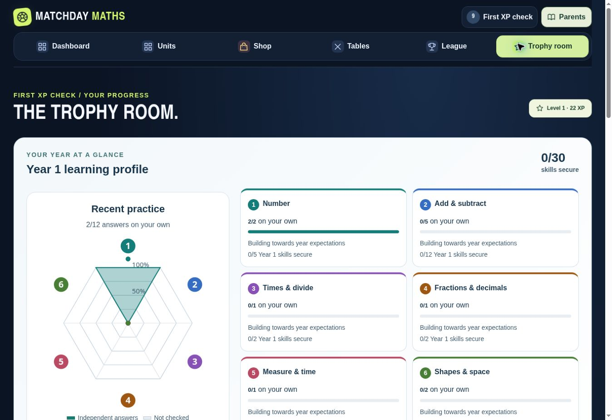

# Follow-up: first lesson, graph and feedback

Requested 8 November 2026, after release 7.1.0.

- Trophy room opens with the year learning graph, before XP details, medals and match history.
- The first warm-up earns career XP for independent answers. Help and unsure answers earn none. Saving part of the first warm-up keeps earned XP; later-year/replayed warm-ups do not restart the award.
- Previously saved first warm-ups are corrected once from their independent answer rows. Existing XP, purchases, starter credits and learning evidence are preserved. Backups carry a validated warm-up receipt to prevent repeat corrections.
- App and resource-page footers link “Part of North Wales Tutoring Group” to https://northwalestutoring.com/.
- The league explanation states that it compares profiles on the same browser and updates after eligible completed Coach matches. Career XP from warm-ups and drills is separate from League XP. Cross-device rankings require a server.
- A five-question Google Form is specified in FEEDBACK_FORM.md. The Dashboard integration is prepared and will use its verified published respondent link. Google Forms required sign-in. The secure sign-in request was not completed, so the form and live Dashboard link remain pending. The prepared button is hidden until a verified respondent URL is available.

Validation so far: 138 automated tests pass, module syntax, public-page generation and Worker packaging pass. Browser verification: the first Year 1 warm-up banked 22 XP for two independent answers and zero XP for ten helped answers, plus 10 starter credits. Reload preserved 22 XP without duplication. The first Trophy room section is the learning graph; the footer links to the supplied site. At 320px, body width and scroll width both measure 305px; report controls stay within the screen. Footer branding is visible and links to the supplied site. Version 7.1.1, syntax, public-page build, Worker packaging and all 138 tests pass.

Release publication is pending GitHub CI and Pages checks. Google Form creation and its live Dashboard button remain pending the owner’s sign-in or a supplied respondent link; no placeholder link is published.
