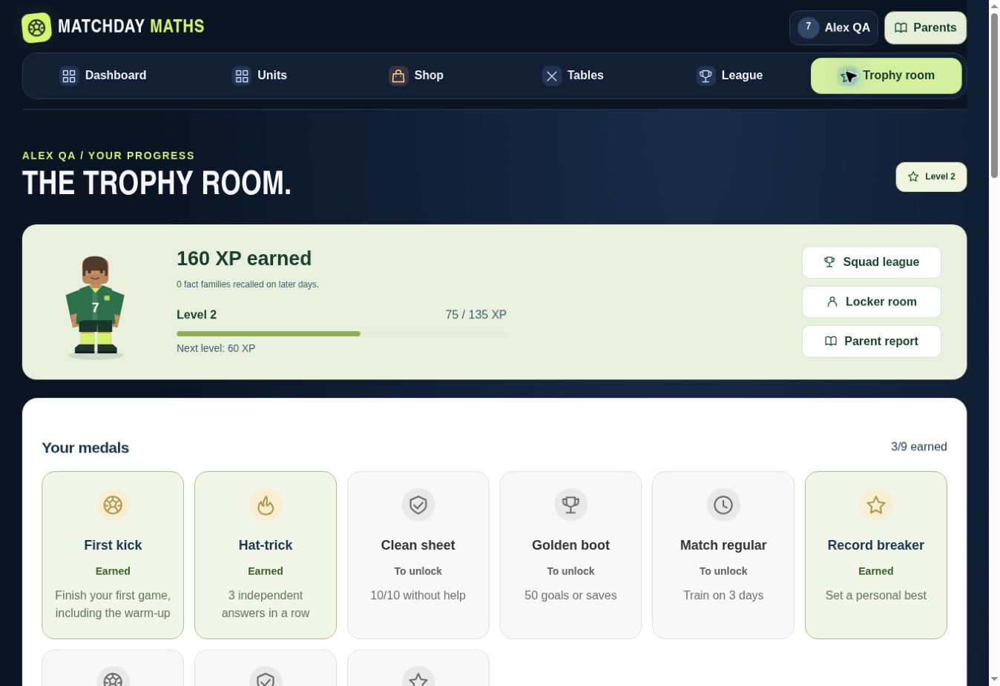
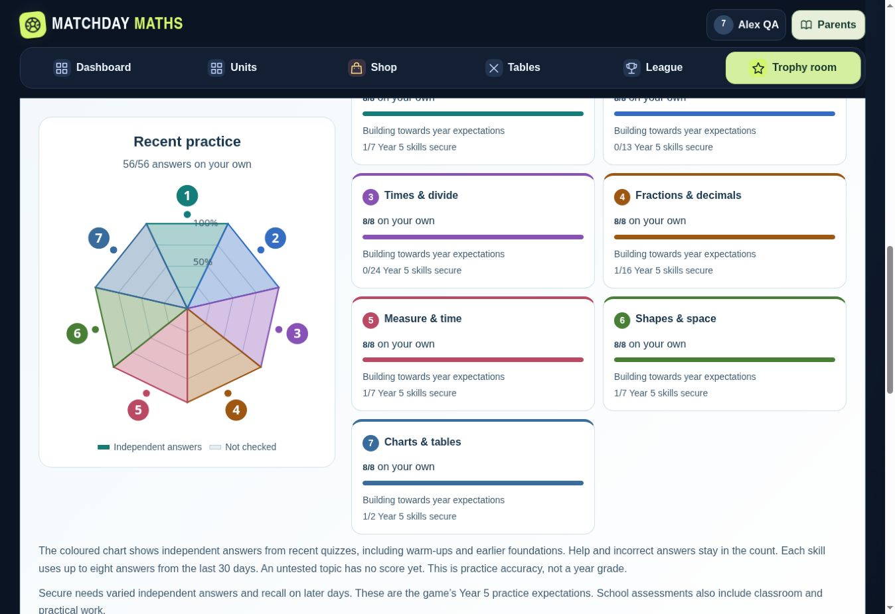

# November 8 launch feedback

Source: Football game-Feedback(1).pdf, 13 pages, supplied 8 November 2026.
Baseline: 7.0.1, main 33a1829. Preserve existing profiles, rewards and learning evidence.

## Release checklist

- [x] Readable body text, navigation and footer on desktop and 320/390px phones. No white gap below footer.
- [x] Dashboard and Trophy room labelled in navigation; Parents and reports easy to find.
- [x] Rounded, spaced navigation with readable hover/focus states.
- [x] Larger player selection cards; aligned match details and league figures.
- [x] Match save controls clearly explain what is saved and which rounds earn credits.
- [x] Goalkeeper plays in goal and saves shots, including correct match feedback.
- [x] Independent Coach drills earn bounded rewards; help and revealed answers earn no XP.
- [x] Pathway begins at starting year, without awarding unplayed years.
- [x] Trophy room includes first warm-up, match history and earned/locked medals.
- [x] Learning profile reflects recent quiz answers, with evidence counts and secure status kept separate.
- [x] Club offer text readable, direct offer action, Shop notification for new offers.
- [x] World League availability explained in plain English with a working local-league action.
- [x] Curriculum guide includes clear return to dashboard.
- [x] Automated logic tests and production builds pass.
- [x] Real browser checks cover complete warm-up, drill rewards/help, goalkeeper, trophies, reports, shop/offers, league, phone layout and reload persistence.
- [x] Version/cache references updated together.
- [x] GitHub CI and published version verified.

## Checkpoints

Each functional group is committed before the next. Final evidence and any remaining hosting limitations will be recorded here before release.

## Browser verification, 8 November 2026

| Area | Observed result |
| --- | --- |
| First Year 5 warm-up | Completed 12 questions; 10 starter credits, First kick and Hat-trick medals. Warm-up visible in history after reload. Pathway shows Years 5 and 6, 0/2 completed. |
| Recent learning | The first warm-up shows 8/12 independent answers across sampled topics, including earlier foundations, with zero invented secure skills. A separate fictional backup with spaced evidence shows 5/76 secure and seven coloured topic sectors. |
| Coach drill | Two independent subtraction answers and one request for help bank 20 XP and 2 credits. Help earns zero XP. The result explains reward eligibility. |
| Written methods at 320px | 4.46 × 2 = 8.92, 6482 × 18 = 116676, and 448 ÷ 28 = 16 remainder 0 accepted through the touch keypad. Long-division Coach working stays within the screen. |
| Goalkeeper | Custom player appears in goal, without a kicker avatar. Correct answers produce SAVE!, a catch animation and matched keeper/ball travel. Wrong answers show a conceded goal. Touch action says Save. |
| Layout | Dashboard at 390px and written methods, reports and League at 320px show no horizontal overflow. Parent report and result text checked on light panels. Footer has 14px text and no obsolete mobile-navigation padding. |
| Rewards and shop | A new Town Rovers offer appears in Shop, opens Club offers and joins successfully. Buying Victory jump deducts 10 credits and runs leap/arm animations. Replay works. |
| League | Fictional 160/110 XP standings display with each value centred over its label on desktop and 320px. Unavailable World League removed from the public launch navigation; direct visits explain the local option. |
| Persistence and backups | Valid two-player backup restored through the normal UI. Idle phone tab receives changed players, club and six-credit balance. Conflicting active play pauses safely; removed profiles return to selection. Idle page exit no longer overwrites newer results. |
| Guides and contrast | Curriculum Back to dashboard opens game 7.1.0. Text-contrast audit returns no issues on the reviewed Trophy room, parent report and phone result views after fixes. |

QA profiles and the imported backup are fictional. No sample pupil data is shipped with the game.

## Release scope

The public GitHub Pages site supports the full local learning game and Squad League on one device. Online ranked World League requires its separate database service, which is not configured on GitHub Pages. Its unavailable entry is omitted from the launch screens; existing direct links have a clear explanation and working Squad League action.

Automated verification: 132 tests passed; module syntax, generated public pages and Worker packaging passed. Existing storage keys and backup version remain compatible.

## Published verification

PR [#3](https://github.com/CleanDesignUK/primary-uk-maths/pull/3) merged with all five development commits intact. Release source commit: `37f139d31fb622864d605405c7a6d360823e79b1`. Merge commit: `e7693758d0d3945f83070ceec2ca6dbd39b1e1a5`.

Both PR/push verification runs passed. On main, [Verify Matchday](https://github.com/CleanDesignUK/primary-uk-maths/actions/runs/42496025098) and [Pages build and deployment](https://github.com/CleanDesignUK/primary-uk-maths/actions/runs/42496024304) completed successfully for that merge commit.

The published [game](https://cleandesignuk.github.io/primary-uk-maths/dist/play/#home) reports application version 7.1.0. Browser smoke checks confirmed a correct first-shot response, creating a Year 5 player, the untimed foundation warm-up, Dashboard navigation, and the unavailable online-league route leading to Squad League. No QA profiles are included in the published source.
